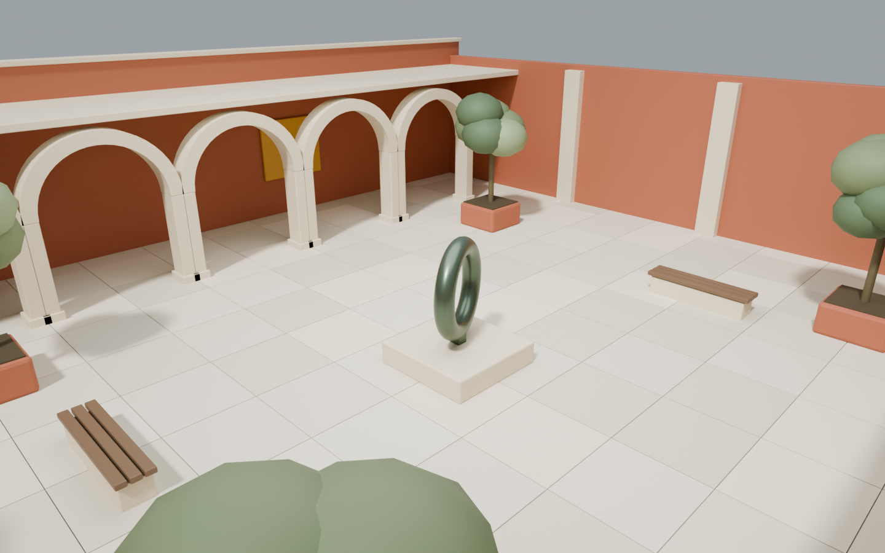

# LocusForge

**让世界回到原点，每一次都有几何证据。**

LocusForge 是面向视频世界模型的回环视频数据工坊：载入有明确授权的 3D 场景，
规划确定性相机路径，真实渲染 RGB 与米制深度，并为满足条件的回访输出可复核的几何证书。

**不使用互联网视频反推相机、不用单目网络恢复尺度、不把图像相似度当作回环真值。**

Locus 意为位置，Forge 意为工坊。项目的重点不是制造更多“看起来绕了一圈”的视频，
而是生产带有明确时间跨度、空间离场、可见重叠和数据来源的数据。



## 1. 交付内容与适用范围

| 部分 | 实现 |
| --- | --- |
| 中文采集工作台 | 场景预览、真实 GLB 三维视口、相机轨迹、时间轴、配方导入 / 导出 |
| 场景资产库 | 原创庭院与展厅；自包含 GLB 上传、SHA-256 去重、授权声明与来源族 |
| 两步路径设计 | 圆形 / 8 字 / 空间控制点 / 组合动作先定义运动，再独立编辑镜头航点 |
| 镜头朝向 | 默认朝前；最短偏航与五次俯仰插值，逐帧零翻滚，闭合端点联动 |
| 路径库 | 场景绑定、SQLite 持久化、版本冲突保护、加载 / 更新 / 另存 / 删除 |
| 自然语言 | 无费用本地语法 + 可选 OpenAI-compatible LLM，显式授权后才联网 |
| 几何预检 | 速度、角速度、加速度；评估后三角网格 BVH；连续相机球净空 |
| 真实生成 | Blender 4.5 LTS / Cycles，显式 CPU / GPU；固定场景时刻与曝光 |
| 回环验收 | 位姿距离、时间跨度、空间离场、双向深度遮挡检查及离场可见性 |
| 数据导出 | 无损 PNG、float32 NPY 深度、K / c2w / w2c、SE(3) 动作、MP4、回环标签 |
| 任务系统 | SQLite WAL 持久化、单协调器锁、取消、重试、恢复中断、日志、容量与超时限制 |
| 部署基线 | 令牌与 HttpOnly 会话、Host / Origin 检查、请求体限额、非 root 容器配置、CI |

这是面向**受信任团队、单工作区**的完整可运行系统，不是多租户公有 SaaS。
商用部署仍需落实资产授权、TLS、隔离、备份和目标硬件验收。
它不宣称已经证明下游模型收益，也不宣称几何合格等同于照片级真实感。

## 2. 为什么选择这条路线

### 2.1 论文中真正值得利用的结论

设计依据包括本地提供的 Infinite-World、SANA-WM、WorldPlay / WorldPlay2 等论文，
并核对了文末的官方网页与渲染器文档。

- **Infinite-World 不是简单地要求“越多回环视频越好”。** 其 §3.3 的 toy study 强调，
  轨迹拓扑多样性、回访密度和训练时间窗口非常重要；§4.1.2 的 RDD 只有约 30 分钟，
  使用 iPhone 17 Pro Action Mode 自采长时、高回访密度视频。这个结果不能被外推为
  “任意 30 分钟数据都足够”，也不能证明短片训练能自动外推任意时长。
- **WorldPlay2 已有 UE 回环渲染先例。** 其附录 B.1 描述前半段探索、后半段严格反向
  遍历相机路径。因而“3D 场景 + 相机轨迹”本身不构成本项目的学术首创。
- **这里排除的是 SANA-WM 的网络视频参数恢复路线。** SANA-WM 的数据组成并不只有
  无真值互联网视频；但其 VIPE + Pi3X / MoGe-2 标注分支依赖估计与尺度恢复，
  不适合本项目“参数直接来自生成过程”的硬约束。

结论：应优先获得**少而准确、回访跨度可控制、具有真实离场且来源多样**的序列，
再扩展场景数量；不能用重复片段、原地停留或大量相邻帧对虚增回环数量。

### 2.2 引擎比较与实际选择

| 路线 | 优点 | 代价与边界 | 本项目选择 |
| --- | --- | --- | --- |
| Blender / Cycles | 原生 PBR、头less 批处理、完整相机与数据通道、可显式使用 OptiX | CPU 长片较慢；需要合适的资产与采样预算 | **已验证的默认生成后端** |
| Blender / EEVEE | 光栅化吞吐潜力高，复用相同资产与相机合同 | 需要图形上下文；屏幕空间、透明与间接光存在限制 | 实验选项，必须在目标设备重新验收 |
| UE Movie Render Queue | 大场景生态、实时光照与电影渲染体系成熟 | 工程体量、版本 / 插件管理和部分资产授权更复杂 | 本轮不安装大型 UE 工程 |
| Habitat-Sim | 导航与传感器采集高效 | 成片质感取决于资产 / 材质；部分扫描数据有单独使用限制 | 不是当前高质量成片主后端 |
| 视频重建 / 单目估计 | 真实世界外观丰富 | 位姿、尺度、深度和遮挡带来不确定性 | **不采用** |

统一使用真实渲染器，而不是另做一个外观相似但标签独立的“假预览生成器”。
前端 Three.js 只负责交互检查，**不冒充最终 Cycles 画面**。

### 2.3 计算预算的合理分层

1. **规划层**：NumPy 计算完整轨迹、速度 / 加速度与数据规模，不启动 Blender。
2. **预检层**：导入一次场景，建立一次 BVH，先拒绝碰撞和异常路径。
3. **试拍层**：180p、4 fps、8 spp 的 `preview` 用于检查路径、曝光和实际秒 / 帧。
4. **生产层**：根据试拍结果选择分辨率、帧率和采样数。建议正式画质使用 Cycles
   GPU、64–128 spp；这只是配置建议，**不是未经实测的吞吐承诺**。
5. **复用层**：一个任务使用一个 Blender 进程，开启静态场景 persistent data；
   不为每一帧重启引擎，也不缓存 / 复制旧 RGB 帧伪装成新拍摄。

一台设备一次执行一个渲染任务。GPU 不存在时显式失败，绝不偷偷回退 CPU 后继续声称 GPU 性能。
环境里只有集成显卡也能使用默认 CPU 链路，但不宜直接排队长时间 1080p 高采样任务。

## 3. 核心方法：把回环变成合同

### 3.1 坐标与时钟先确定

- 世界坐标：右手系，**Z 向上，单位米**。
- 相机坐标：OpenCV 约定，**X 向右、Y 向下、Z 向前**。
- `c2w`：相机坐标到世界坐标的齐次变换；`w2c = inverse(c2w)`。
- 无镜头畸变、无相机 shift，像素宽高比为 1。
- 相机裁剪范围为 0.02–1000 米；`height` 是绝对世界 Z，不是自动估计的离地高度。
- 水平视场角为 θ 时，`fx = fy = width / (2 tan(θ/2))`。
- 坐标以图像边界为原点：数组 `[v, u]` 的像素中心是 **`(u+0.5, v+0.5)`**，
  主点为 `(width/2, height/2)`，不能再混用整数中心约定。

相机矩阵从实际 Blender 相机读回，内参同时通过
`calc_matrix_camera` 检查，不能仅把请求参数原样写成“已实现真值”。

对于时长 `T`、帧率 `f`：

```text
N = T × f
第 i 帧曝光时刻 = i / f，i = 0 ... N-1
精确闭合发生在最后一个曝光样本：(N-1) / f
编码视频时长 = N / f = T
```

例如 30 秒 / 24 fps 是 720 帧，最后一个样本在 29.958333… 秒；
没有偷偷增加第 721 帧，也不把 30 秒终止边界当成第 720 帧时刻。
序列末尾确实重新渲染相同相机姿态，不是拼接或倒放文件。

### 3.2 路径与碰撞

环游和 8 字路径先密集采样，再按累计弧长重采样。控制点模式采用周期
Catmull–Rom 曲线，闭合至少四个控制点，开放至少两个。新路径默认沿运动方向。
历史配方明确指定的 `heading="target"` 仍保留，不改写旧任务或已导出数据。

曝光样本之间的碰撞合同采用**相机中心的分段线性连接**，而不是宣称已穷尽母曲线每一点。
镜头朝向按下文的无翻滚 yaw / pitch 构建，不对任意四元数插值后再强制抹除 roll。
预检对实际执行的相机线段进行细分，最大步长不超过相机半径的一半。
距离到表面函数是 1-Lipschitz；额外要求 `clearance >= radius + step/2`，
使检查覆盖采样点之间的间隙，而非只检查每帧的位置。

此外进行六方向首个交点的面朝向检查，保守拒绝相机处于实体内部或明显倒法线区域的路径。
这不是完整人形角色导航，也不是对任意非流形扫描网格的数学内外判定。
错误法线、开放背面或复杂扫描会导致保守拒绝，需修复资产。

**8 字路径不会自动绕过雕塑。** 原创庭院的安全参考区域见
[figure-eight.json](examples/figure-eight.json)；对任意导入场景必须在三维视口检查并实际预检。
“对齐路径”只对齐包围盒中心，不等于生成可通行导航路径。

### 3.3 深度不能只凭通道名字猜

RGB 是抗锯齿的美术渲染；几何数据来自无滤波的世界位置通道。
先做 `P_camera = w2c × P_world`，取其 Z 作为米制轴向深度。
Depth 通道用于有效表面筛选，不假设它在所有引擎下都等于相机射线欧氏长度。

实际测试发现，倒角等表面的着色位置可能略微偏离像素中心射线。
在 640 × 360 样本中，原始位置通道的最大投影偏差实测约 **0.293 px**。
直接把它当作严格中心射线深度会留下隐蔽误差。

因此实现了**稀疏中心射线修正**：

1. 对所有有效位置像素投影回图像，测量真实的中心偏差。
2. 偏差超过 **0.005 px** 的像素，使用同一静态、已求值三角网格 BVH
   从精确相机中心重新发射该像素射线，替换其轴向深度。
3. 其他像素保留渲染器位置通道结果，不重新逐像素 CPU 渲染整个视频。
4. 若原始偏差超过 2 px，或需修正像素超过有效像素的 25%，直接失败，
   防止以“修正”掩盖系统性的相机约定错误。
5. 最终投影门限仍为 **0.02 px**，没有为了让样本通过而放宽门限。

实测均衡样本只修正约 0.17% 的总像素，最终最大偏差小于 0.005 px。
该值是模拟器数据通道的数值一致性检查，**不是现实世界测量误差承诺**。
场景单位的物理真实性仍取决于导入者提供的正确比例。

### 3.4 EOC：离场—遮挡—回访证书

这是本项目的数据工程设计，不宣称经过学术优先权检索的全新算法。

对候选帧 `(i,j)`，同时要求：

| 条件 | 默认值 |
| --- | --- |
| 时间间隔 | `t_j - t_i >= 5 s` |
| 位置误差 | `||p_j - p_i|| <= 0.25 m` |
| 旋转误差 | 相对旋转角 `<= 8°` |
| 中间最大离场 | `max_k ||p_k - p_i|| >= 3 m` |
| 双向可见重叠 | `min(overlap_i_to_j, overlap_j_to_i) >= 0.8` |
| 最远离场时的原视图支持 | `overlap_i_to_departure <= 0.35` |

可见重叠计算：

```text
P_i = D_i(u,v) · inverse(K) · [u+0.5, v+0.5, 1]
P_world = c2w_i · P_i
P_j = w2c_j · P_world
(u_j, v_j) = project(K, P_j)
```

投影必须位于目标视野内，且目标深度满足：

```text
abs(D_j(floor(u_j), floor(v_j)) - P_j.z) <= max(0.03 m, 0.01 × P_j.z)
```

分别从两个方向计算，取较小值。分母是来源视图中采样到的有效几何点，而不是只统计
落进目标视图的点，从而避免把很小的共同区域误报成 100% 重叠。

采用空间哈希检索候选，最多检查 256 个候选、保留 64 个通过帧对；不是 O(N²)
遍历所有像素对，也**不承诺穷举所有回访**。末帧闭合对会进入候选集，但仍须真实通过离场和遮挡检查。

输出同时保留：

- 精确 / 近邻回环类别、两个方向的重叠率和采样数量；
- 离场帧、离场距离、离场可见比例；
- 未通过候选及拒绝原因；
- `0–10 / 10–30 / 30–60 / 60+ s` 的回访跨度直方图。

### 3.5 防止数据规模看起来很大、实际却泄漏

划分规则是：

```text
bucket = first_uint32(SHA256("locusforge-split-v1:" + source_group)) % 100
0..79 → train，80..89 → validation，90..99 → test
```

同一 GLB 指纹不允许注册成不同的 `source_group`。
改色、裁剪、重导出和共享房间的派生资产也应该使用同一来源族；这部分依赖操作员正确归组，
不能靠字节 SHA 自动识别所有近似场景。少量场景时不保证恰好 80 / 10 / 10 的数量比例。

改变渲染随机种子主要改变采样，**不是增加场景语义多样性**。

### 3.6 两步设计：运动路径与镜头姿态解耦

**第一步只决定相机经过哪里。** 三种入口共享同一类型合同与规划器：

1. **几何模板**：圆形、8 字、开放 / 闭合空间控制点。适合圆形等不方便靠按键累积的形状。
2. **动作积木**：精确直线、圆弧、原地转向、停留；支持前后左右及上下平移。
3. **自然语言草稿**：解析后先展示摘要、假设与运动学门限，用户点击采用才进入编辑器。
   解析接口不会提交渲染任务。

动作积木的 `start` 是世界起点，`start_yaw_deg=0` 对应 +X，
正角向右转，即朝 -Y。直线动作相对**导航朝向**：
前进 / 后退 / 左移 / 右移不会改变导航轴，只有圆弧与原地转向会改变它。
圆弧半径和角度直接参与解析几何计算，不先近似成稀疏多边形。

为了兼顾“准确位移”和“镜头默认朝向实际运动”，不同方向的直线间插入明确的
**原地平滑转向**。这些段会出现在编译时间线上，参与总时间分配；
不会暗中把直角轨迹圆滑到墙里，也不会在角点瞬间跳转镜头。
每个动作使用 `6u⁵−15u⁴+10u³` 缓动，起止速度 / 加速度为零。
纯升降没有唯一水平切向，保留最近的水平航向，抬头 / 低头由第二步明确设置。

`weight` 是**相对时间权重，不是秒**。每圈的全部动作与自动转向一起归一化，
再按 `laps` 分配全片曝光时间窗。需要更慢的角点或停留可以增加该段权重或总时长。
开启 `closed` 不会补回程：动作结果未闭合就报告真实端点误差，禁止瞬移末帧过关。
开放路径允许设计和保存，但既有回环验收仍然适用。

**第二步决定相机沿路看向哪里。**

```json
{
  "heading": "forward",
  "orientation_keyframes": [
    {"at": 0, "yaw_deg": 0, "pitch_deg": -10},
    {"at": 0.25, "yaw_deg": 30, "pitch_deg": 8},
    {"at": 0.5, "yaw_deg": -40, "pitch_deg": -15},
    {"at": 0.75, "yaw_deg": 20, "pitch_deg": -5}
  ]
}
```

- `at` 为**整段视频**的归一化进度，`t = at × (N−1)/fps`，不是每圈重复的进度。
  改分辨率或帧率不改变设计意图；改变全片时长会按比例伸缩。
- 偏航 `yaw_deg`：相对前进方向，**右为正、左为负**，范围 ±180°。
- 俯仰 `pitch_deg`：相对前进方向的俯仰，**上为正、下为负**；
  合成后的绝对俯仰必须在 ±85° 内，避免竖直奇点，不静默截断。
- 相邻偏航取最短角，并用五次缓动插值；例如 +170° 到 −170° 经过 +180°，
  而不是扫过 340°。要表达完整转一圈，请添加中间角度航点。
- 偏角插值在航点处 C² 连续、无超调；整体朝向还取决于基础路径的切向。
- 每帧由 `forward` 和世界 Z 轴重建 `right/down`；**没有 roll 输入字段**，
  也不采用会在中间帧产生翻滚的任意 SO(3) 四元数插值。
- 闭合路径的末端偏角默认与起点联动；没有起点航点时从 0° / 0° 开始。
  若显式写 `at=1`，必须与起点物理方向一致，否则拒绝。
- 开放路径未写末端航点时保持最后一个偏角；不擅自归零。
- 相邻镜头航点与动作段至少覆盖两个采样间隔，速度 / 角速度仍须通过门限。
  增加航点不能绕过已有几何或回访验收。

界面支持点击三维轨迹或移动时间轴选择帧，在该位置添加航点；金色点表示镜头航点。
重复经过同一空间位置时，用时间轴选择具体哪一次经过。
「相机视角」使用同一 K / c2w 和输出宽高比，留黑边而不是拉伸画面，
但仍明确属于 Three.js 几何预演，不是 Cycles 画质预览。

### 3.7 路径保存与并发编辑

路径库保存在同一工作区数据库，包含名称、备注、场景 ID、源资产 SHA-256、
完整运动参数、镜头航点、时长、创建时间和版本号。
**保存路径不等于认证数据**：不满足运动学门限的草稿可以保存，渲染提交仍会拒绝。

加载时验证源场景指纹；绝对坐标不会自动适配其他场景。
更新和删除须提交当前 `revision`，并发修改返回 HTTP 409，不能覆盖另一窗口的编辑。
另存生成新 ID，删除不影响已排队或已完成任务，因为任务持有完整不可变配方快照。
单工作区最多保存 1,000 条设计，列表可分页。

0.1 数据库首次启动 0.2 时自动迁移；迁移前通过 SQLite backup API 创建
`data/backups/before-path-library-v2.sqlite3`。旧场景、任务和导出包不被重写。

## 4. 快速开始

### 4.1 当前已交付工作区

本地已经准备了独立的 **Conda `locusforge` 环境**，包含 Python、Node、图形运行库
以及安装在该环境内部的官方 Blender，不依赖其他项目的环境。
使用 WSL / Linux 终端进入项目根目录：

```bash
bash scripts/start.sh
```

打开 **http://127.0.0.1:8765**。如果已有服务占用该端口，直接访问，不要重复启动。

本地 `.env` 使用 `LOCUS_CONDA_ENV=locusforge`、`LOCUS_BLENDER=blender`。
启动脚本会激活环境再运行服务；无需预先激活，也不再使用 `.venv`。

### 4.2 新机器安装

Git 仓库包含应用源码、Conda 配置、依赖锁文件、启动脚本、测试及两套原创场景资产。
克隆后进入项目根目录，执行下面的安装和启动命令即可，不需要复制本机环境或预先构建的前端。
`.env.example` 是可提交的配置模板；真实 `.env`、`api.key`、运行数据库、上传资产和生成数据
均不纳入版本控制。个人保存的路径库位于 `data/`，需要时通过配方导出或单独备份迁移。

自动安装支持 **Ubuntu / Linux x86_64 与 WSL**。新机器只需先安装 Miniforge / Conda，
让 `conda` 命令可用；不要把旧机器的环境目录直接复制过去。
应用 Python 3.12 与 Blender 自带 Python 是两个运行时，不向 Blender 内部安装 FastAPI。

```bash
# 在项目根目录执行。整个过程可重复，不覆盖其他项目的环境。
bash scripts/setup.sh
bash scripts/start.sh
```

脚本顺序：

1. 根据 [environment.yml](environment.yml) 创建或更新名为 `locusforge` 的 Conda 环境。
2. 安装 Python 3.12、Node.js 24 与 Blender 所需的 X11 / EGL 共享库。
3. 根据 `requirements.lock` 安装已验证 Python 依赖及当前项目。
4. 将官方 Blender 4.5.3 下载至 `$CONDA_PREFIX/opt/`，校验固定 SHA-256，
   建立环境内 `bin/blender` 启动器并实际运行 headless 检查。
5. 执行 `npm ci`、TypeScript / Vite 构建并注册原创场景。

Blender 4.5 LTS 不在本轮查询到的 conda-forge 包中，所以没有写一个无法求解的
`blender=4.5` 依赖；使用经过 SHA-256 校验的官方二进制，仍安装在专用 Conda 环境内。
下载有有限次显式重试；校验失败或运行库缺失都会中止，而不是带着缺失组件“安装成功”。

```bash
# 可选配置：首次创建，不覆盖已有凭据。
test -f .env || cp .env.example .env

# Conda 未加入 PATH 时，显式指定安装位置：
CONDA_EXE=/your/miniforge3/bin/conda bash scripts/setup.sh
CONDA_EXE=/your/miniforge3/bin/conda bash scripts/start.sh

# 非默认环境名：setup 与启动使用同一个名字，不能使用 base。
LOCUS_CONDA_ENV=locusforge-prod bash scripts/setup.sh
# 然后在 .env 中设置 LOCUS_CONDA_ENV=locusforge-prod。
```

FFmpeg 由 `imageio-ffmpeg` 提供固定包内二进制，不要求另装系统 FFmpeg。
Python 与 npm 依赖分别由 `requirements.lock`、`web/package-lock.json` 固定。
Conda 求解器将 Python 限定在 3.12、Node 限定在 24；这不是逐字节锁定所有平台底层包，
上线时仍应运行下面的标定测试。更新时关闭正在采集的服务，再重新运行 `setup.sh`。
项目本轮不保证原生 Windows Blender、macOS / Metal 或 ARM64 的兼容性。

迁移时复制项目源代码、原始资产和所需的 `data/`，**不复制 Conda 环境、node_modules
或旧 `.venv`**。先停服再一致性迁移数据库 / WAL 与 assets / jobs；密钥另行配置。
安装脚本只改专用 Conda 环境，不触碰 WorldScale、其他训练环境或数据集。

### 4.3 前端操作

1. **场景资产**：使用内置原创场景，或导入有权使用的自包含 GLB。
2. **路径设计器 → 运动路径**：选择圆形 / 8 字 / 控制点 / 组合动作，或解析自然语言草稿。
3. **路径设计器 → 镜头航点**：默认朝前；点击路径或时间轴选位置，添加左右 / 上下角度，
   切换「相机视角」检查构图。保存可跨刷新 / 重启复用，应用才改变工作台配方。
4. **采集配方**：设置视场、规格、固定光照、设备、种子和验收门限。
5. **加入队列**：先显示数据规模与用途确认，再冻结配方与源资产。
6. **渲染任务**：检查真实帧进度、取消、复制配方或新建重试。失败不会被显示为完成。
7. **数据集**：播放实际 MP4，对照首访 / 离场 / 回访帧，查看验收证书并流式下载 ZIP。

`preview` 即使验收通过，也明确标记为 `training_eligible=false`。
`dataset` 只有全部门限通过才发布。这里的资格指满足几何与文件合同，
不是自动通过主观美学评审；使用时还必须尊重 manifest 的 train / validation / test 划分。

### 4.4 命令行与批量排队

```bash
conda activate locusforge

locusforge init
locusforge plan examples/preview.json

# 已有 studio / worker 正在运行时，只排队：
locusforge capture examples/preview.json
locusforge capture examples/figure-eight.json
locusforge capture examples/looking-loop.json
locusforge capture examples/compound-loop.json

# 没有其他协调器运行时，CLI 可以自己启动 worker 并等待结果：
locusforge capture examples/preview.json --wait

# CPU 均衡质量示例；明显慢于预览档：
locusforge capture examples/balanced.json

# 720p / 24fps / 60s / OptiX；需要真实可用的 NVIDIA OptiX 设备：
locusforge capture examples/dataset.json

# 校验整个导出目录或 ZIP 的所有文件：
locusforge verify data/jobs/JOB_ID/dataset.zip
```

`--wait` 不会抢占已经存在的 worker；锁冲突会明确报错。
队列默认最多 100 个待处理 / 执行中任务，单任务最多 10,800 帧。
对大量配方可逐个调用 `capture`；失败任务重试生成新 ID，不覆盖原始结果。

### 4.5 自然语言与 LLM 配置

**本地语法默认可用，不用 API、不付费、不联网。** 它是严格语法解析器，不冒充通用大模型：

```text
圆形；半径5.5米；高度1.7米；时长30秒
前进4米；右移3米；后退4米；左移3米；闭合；时长40秒
右弧3米360度；闭合；时长30秒
上升1米；前进4米；下降1米；后退4米；闭合；时长40秒
```

使用阿拉伯数字，以分号或逗号分隔；未知片段会明确拒绝，不能被静默丢弃。
「上升」移动相机，「抬头」属于第二步的俯仰航点，二者不能混淆。
圆形模板默认以世界 (0,0) 为中心，动作路径从编辑器的 `start` 开始，
摘要会说明默认值。不会根据场景名称猜测哪里有门、墙或道路。

可选 LLM 沿用 WorldScale 的 **OpenAI-compatible Chat Completions** 调用方式：
Bearer 鉴权、JSON object 输出、有限超时、结构校验、内容缓存和脱敏审计。
默认端点为 DMXAPI，默认模型 `gpt-5.4-mini`；管理员可替换兼容服务。
不自动读取或复制 WorldScale 的密钥。

```bash
# .env 中的非秘密配置：
LOCUS_LLM_ENDPOINT=https://www.dmxapi.cn/v1/chat/completions
LOCUS_LLM_MODEL=gpt-5.4-mini
LOCUS_LLM_KEY_FILE=./api.key
LOCUS_LLM_TIMEOUT_SECONDS=45
LOCUS_LLM_DAILY_LIMIT=20
```

把自己的密钥保存在未纳入版本控制的 `api.key` 中，仅一行；或设置
`LOCUS_LLM_API_KEY` 环境变量（优先级更高）。这是**模型服务密钥**，
不要与保护工作台的 `LOCUS_API_TOKEN` 混用。配置后重启服务。
非回环 LLM 地址必须为 HTTPS，不跟随重定向；本机自托管兼容服务可用 loopback HTTP。

在自然语言入口显式选择「LLM」并确认本次外发，才发送描述、起点与导航朝向。
**不发送 GLB、图片、历史任务、代码或工作区文件**；不要在描述中输入私密信息。
前端不接收密钥，渲染子进程也不继承模型凭据。

- 只接受有类型约束的路径 JSON；不接受 Python、脚本、工具调用或任意配置。
- 第一步不得生成镜头 keyframe、roll 或修改渲染门限。
- 结果先显示摘要 / 假设，用户采用后仍要预演与几何验收；模型不是安全导航器。
- 最多两个并行解析，持久化 UTC 每日调用预算；失败也计入预算。
- 相同请求 / 端点 / 模型 / 系统合同的成功结果可复用缓存；不自动付费重试。
- 响应最多 128 KiB；截断、拒答、错误 JSON、未知字段、超时与上游错误均明确失败。
- 审计只保存请求摘要哈希、调用 ID、模型、状态、用量和已验证设计，
  不保存原始描述或未通过的供应商响应。设计本身仍可能包含用户输入的名称，应按工作区数据保护。
- 本轮对供应商协议使用本地可控 HTTP transport 验证，**没有动用已有账户密钥进行真实付费调用**；
  上线前需用自己的服务做一次小额连通性验收。

## 5. 资产与画质

### 5.1 自包含 GLB 合同

- glTF 2.0 二进制，嵌入模型和贴图；禁止引用磁盘外部文件或远程资源。
- 只接收不透明三角网格；拒绝 `MASK / BLEND` 和透射玻璃。
- 必须填写来源、署名、许可、米 / 单位、来源场景族，并分别确认商业与训练用途授权。
- 默认单资产上传上限 1,024 MiB；JSON 头上限 16 MiB。
- 渲染预检上限为 400 万顶点 / 200 万多边形；超出时请先优化资产，而不是赌进程不会 OOM。
- 资产动画在第 1 帧冻结；当前版本不生成动态物体状态 / scene flow 标签。
- 未支持的 required glTF 扩展会拒绝，包含目前未实现的压缩解码路线。

**光照有两个显式模式**：

- `daylight`：固定日光与天空补光，适合内置场景、室外或开放天窗空间。
- `asset`：保留 GLB 的静态灯光 / 自发光材质，适合封闭室内。
  无灯光的封闭房间不会被“智能补亮”成另一个场景；请在源资产中布置灯光。

Blender 的法线贴图、PBR 材质和实际三角几何可复用。镜面反射里的虚像不是深度表面：
输出深度对应第一个不透明几何交点，不声称提供反射对象的真实深度或稠密光流。

### 5.2 哪里获取更高真实感资产

内置原创庭院 / 展厅用于开箱运行和验收，**不是照片级真实感基准**。
正式生产应选择高质量扫描 / 建模、PBR 纹理、正确比例和明确权利链的资产：

- 自有建筑 / 室内工程：优先，保留来源版本与实际比例。
- Poly Haven：CC0 资产适合组成场景，但网站内容、截图、API 与资产授权不是同一回事；
  不把网站禁止的抓取当作数据采集方式。
- Infinigen：可作为离线资产生产端，审查具体版本及第三方资产许可后导出 GLB。
- 商业资产商城：逐项确认衍生图像、训练用途、自动化采集及再分发条款。
- HM3D 等扫描数据：不要因为“能下载”就默认允许商业训练。

项目不会自动下载带有非商业限制的数据，也不随导出包再分发上传的原始 GLB。

### 5.3 画质与记忆训练的取舍

固定 AgX、曝光、种子和场景时间；关闭运动模糊、景深与动画随机种子。
Cycles 采样数不低于 16 时启用去噪，关闭自适应采样以明确每像素预算。
去噪仍可能带来细小帧间差异，复杂反射 / 高频纹理需要提高采样并人工抽检。

建议按 12 / 30 / 60 / 120 秒、不同拓扑、朝向和离场程度安排配额，
同时检查回访跨度直方图；不要把多数样本都集中在很短的首尾闭合上。
验证训练收益时，应按**新场景 + 新路径 + 新回访跨度**评测，
并做“只用短回环 / 加入长回环 / 加入真实离场约束”的消融。
这些是可执行的实验建议，不是本仓库已经完成的模型训练结论。

## 6. 导出格式

```text
dataset.zip
├── manifest.json       # 来源族、划分、权利声明、逐文件大小与 SHA-256
├── recipe.json         # 不可变采集配方
├── scene.json          # 源资产指纹、尺度、署名和授权记录
├── cameras.json        # 真实 K、逐帧 c2w / w2c、时间戳和坐标约定
├── actions.jsonl       # N-1 个相邻曝光间的 SE(3) 相对运动
├── loops.json          # 通过与拒绝的回环候选、离场证据、跨度统计
├── quality.json        # 数值验收、引擎版本和实测耗时
├── video.mp4           # H.264 CRF 18 / yuv420p 审阅代理
├── rgb/000000.png      # 无损 RGB，规范训练像素
└── depth/000000.npy    # H × W float32，相机轴向米制 Z；0 表示无效
```

动作定义：

```text
T_camera_from_next_camera = w2c_i × c2w_(i+1)
```

其平移是在当前相机坐标中表达的下一相机位置；旋转把下一相机轴变换到当前相机轴。
另有 `dt_seconds` 和当前相机坐标中的米 / 秒速度。
它不是按键日志，也不把真实运动硬映射成可能歧义的 W / A / S / D 标签。
0.2 的 `cameras.json` 合同版本为 1.1：另含 `orientation_command`、从实际引擎矩阵
读回的 `actual_orientation`、镜头航点与单圈运动时间线。命令角度与实际值分开记录；
实际 roll 超过 0.001° 会验收失败，不用写死的 0 冒充观测结果。

```python
import json
from pathlib import Path
import numpy as np
from PIL import Image

root = Path("extracted_dataset")
manifest = json.loads((root / "manifest.json").read_text())
assert manifest["training_eligible"]
# 训练阶段还应要求 manifest["split"] == "train"。
cameras = json.loads((root / "cameras.json").read_text())
frame = cameras["frames"][0]
rgb = np.asarray(Image.open(root / frame["rgb"]))       # uint8, H×W×3
depth = np.load(root / frame["depth"], allow_pickle=False)
K = np.asarray(cameras["intrinsics"])
c2w = np.asarray(frame["c2w"])
```

SHA-256 用于文件完整性，不等于数字签名或对恶意替换整个 manifest 的认证。
下载前可保存任务 API 返回的 archive SHA-256 作为独立校验依据。

## 7. 实测，而不是演示数字

在本机 Intel Core i7-1370P、Ubuntu 24.04 / WSL、Blender 4.5.3 LTS、
**Cycles CPU 4 线程**下实际完成：

| 样本 | 规格 | 实测渲染中位数 | RGB-D 渲染合计 | 导出 |
| --- | --- | --- | --- | --- |
| 轻量预览 | 320×180，4 fps，12 s，8 spp，48 帧 | 0.375 s / 帧 | 18.15 s | 约 11.7 MiB；不标记为可训练 |
| 均衡数据 | 640×360，8 fps，12 s，32 spp，96 帧 | 8.846 s / 帧 | 850.90 s | 约 64.4 MiB；全门限通过 |

计时包括逐帧渲染、位置数据处理与保存，不包括整次任务的资产导入、预检、编码和封装。
硬件负载、材质与场景复杂度会改变结果；不能将这些数字当成 GPU 吞吐量。

0.2 升级后，在新建的独立 Conda 环境中又实际完成两条序列：

| 新样本 | 规格 | 实测 RGB-D 渲染合计 | 引擎读回的最大 roll | 认证帧对 |
| --- | --- | --- | --- | --- |
| 环游 + 左右 / 上下镜头航点 | 320×180，4 fps，24 s，96 帧 | 45.33 s | 0.00000779° | 1 |
| 四段平移 + 原地转向 + 镜头航点 | 320×180，4 fps，32 s，128 帧 | 70.73 s | 0.00000920° | 15 |

新样本全部通过既有门限、零翻滚检查、完整视频解码和逐文件校验；
第一条实际俯仰覆盖约 −15° 到 +8°，并非只有平移或只在前端画出旋转。
最大位置投影残差均小于 0.005 px。两条为预览验证，不标记为正式训练集。
这里的计数是**通过认证的帧对**，不是 15 个独立拓扑回环；同一回访附近可以产生多个相关帧对。

均衡样本的实际证据：

- 完整解码 **96 帧**，分辨率 640×360，8 fps，视频时长严格 12 秒。
- 回访时刻差 **11.875 秒**，首尾实际位姿误差 **0 m / 0°**。
- 两个方向的回访重叠均为 **100%**；离场时支持约 **14.1%**。
- 相机最大离场约 **11 m**，不是原地重复。
- 修正后的最大位置投影残差 **< 0.005 px**；验收门限保持 0.02 px。
- ZIP 中逐文件 SHA-256 可独立复核。

实际任务与完整报告保留在工作区的 `data/jobs/`，不是写死在前端的假数据。
开发期间被拒绝的校准任务也不会获得可下载的合格数据包。
另经真实浏览器完成了 80 帧 8 字轨迹的配方导入、取消、新建重试及完整验收，
得到 3 个认证回访；该试拍仍明确标记为 `preview`。

0.2 在独立 Conda 环境中通过 **82 项 Python 测试**（其中包含实际 Blender 渲染）
和 **15 项前端测试**，覆盖路径、插值、多圈语义、并发保存、LLM 协议和真实镜头姿态；
Python 类型检查、前后端 lint 和生产构建也通过。测试适配层有一项上游
Starlette / httpx 弃用提示，不影响已执行的结果；不将其描述为零警告构建。

验证命令：

```bash
conda activate locusforge
ruff check src tests scripts
mypy src/locusforge --exclude blender
pytest -m "not renderer" -q

# 包含真实 Blender 平面标定、720p 非方形图像和实体内相机拒绝：
pytest -q

npm --prefix web run test
npm --prefix web run lint
npm --prefix web run build
```

此外已使用真实浏览器检查三维 GLB 加载、资产上传、证书帧对、原生视频元数据和 Range 下载。
路径设计器另验证了真实三维路径点选、俯仰 / 偏航编辑、保存 / 更新 / 刷新加载、
本地语言解析及错误拒绝、未配置 LLM 的明确禁用、移动端保存 / 删除和无横向溢出。
前端主 JS gzip 约 98 kB，Three.js 与 GLB 交互代码在打开三维视口时才按需加载。
构建器对 Three.js 的原始 chunk 大小提示不代表它被加入首屏主 bundle。

## 8. 任务可靠性与 API

正常状态：

```text
queued → preflight → rendering → validating → packaging → succeeded
                    ↘ rejected / failed / cancelled
```

- 失败原因、门限值、观测值和渲染日志均可查看。
- ZIP 先写临时文件，完整完成后原子替换；只为 `succeeded` 发布下载。
- 所有 RGB / Depth / 相机行必须等长、连续且同序；MP4 编码后再次完整解码检查。
- “非冻结画面”检查基于像素内容哈希，不会被 PNG 元数据变化欺骗。
- 默认保留 10% 可用磁盘余量，并预留未压缩 RGB-D 约 2.2 倍空间及额外工作空间。
- 默认单任务超时 6 小时。取消会终止本任务子进程，不杀其他 Blender / Python 进程。
- 重启时将未完成任务标记为明确失败，不把残留文件冒充成功结果；重试生成新任务。
- SQLite 与资产 / 任务目录应放本机磁盘，不支持在 NFS 上靠 WAL 和文件锁拼成分布式队列。

| API | 用途 |
| --- | --- |
| `GET /api/health` | 最小健康检查，不泄露路径或凭据 |
| `GET /api/system` | 真实队列、协调器、磁盘和数据统计 |
| `POST /api/session` | Bearer token 验证后建立 HttpOnly 会话 |
| `GET /api/scenes` / `POST /api/scenes` | 场景列表 / multipart GLB 与 metadata 导入 |
| `POST /api/plan` | 校验并标准化配方，返回完整轨迹与运动学门限 |
| `GET /api/paths?scene_id=...` / `POST /api/paths` | 分页查询 / 持久化保存场景绑定的路径 |
| `GET /api/paths/{id}` / `PUT /api/paths/{id}` | 加载 / 携带 revision 更新路径 |
| `DELETE /api/paths/{id}?revision=N` | 带版本保护的删除；不删除任务 |
| `GET /api/planner/capabilities` | 本地 / 云端可用性与费用边界，不返回密钥 |
| `POST /api/planner/parse` | 解析运动草稿；不保存、不执行、不提交渲染 |
| `POST /api/jobs` | 提交不可变任务，支持 `Idempotency-Key` |
| `GET /api/jobs?limit=50&offset=0` | 分页任务列表 |
| `GET /api/jobs/{id}` | 状态、验收报告和事件 |
| `POST /api/jobs/{id}/cancel` / `retry` | 取消 / 新任务重试 |
| `GET /api/jobs/{id}/loops` / `log` | 回环证据 / 有限长度日志 |
| `GET /api/jobs/{id}/download` | 已完成 ZIP，支持流式与 Range |
| `GET /api/openapi.json` | 受同等鉴权保护的完整接口合同 |

上传 metadata 字段见 OpenAPI 的 `SceneInput` 约定或前端表单；
场景 ID 由服务生成，无法用上传文件名穿越输出目录。

## 9. 商用部署基线

### 9.1 配置

| 环境变量 | 默认 / 作用 |
| --- | --- |
| `LOCUS_DATA_DIR` | `./data`；数据库、内容寻址资产、任务结果 |
| `LOCUS_CONDA_ENV` | `locusforge`；宿主 setup / start 选择的专用 Conda 环境 |
| `LOCUS_BLENDER` | `blender`；Conda 激活后解析到该环境安装的固定版本 |
| `LOCUS_RENDER_THREADS` | `4`；显式限制本任务 CPU 使用 |
| `LOCUS_EMBEDDED_WORKER` | `true`；API 内嵌单协调器 |
| `LOCUS_API_TOKEN` | 本机可留空，非回环绑定必须设置 |
| `LOCUS_ALLOWED_ORIGINS` | 明确允许的来源，不使用 `*` 搭配凭据 |
| `LOCUS_TRUSTED_HOSTS` | 明确列出域名；默认 localhost / 127.0.0.1 |
| `LOCUS_MAX_ASSET_MB` | `1024`，最大可配 8192 |
| `LOCUS_JOB_TIMEOUT_SECONDS` | `21600`，最大 7 天 |
| `FORWARDED_ALLOW_IPS` | 仅信任实际反向代理地址，用于 HTTPS 转发头 |
| `LOCUS_LLM_ENDPOINT` / `LOCUS_LLM_MODEL` | 可选模型服务地址 / 模型，见 §4.5 |
| `LOCUS_LLM_API_KEY` / `LOCUS_LLM_KEY_FILE` | 模型密钥环境变量 / 仅服务器读取的文件 |
| `LOCUS_LLM_TIMEOUT_SECONDS` / `LOCUS_LLM_DAILY_LIMIT` | `45` 秒 / `20` 次；0 次可禁用云端解析 |

`.env` 由 `scripts/start.sh` 读取；直接调用 CLI 时使用已经导出的环境变量。
只加载自己管理的 `.env`，它不是不可信上传文件格式。

非回环绑定必须显式设置高熵令牌，例如：

```bash
export LOCUS_API_TOKEN="$(python -c 'import secrets; print(secrets.token_urlsafe(32))')"
export LOCUS_TRUSTED_HOSTS="render.example.com,127.0.0.1,localhost"
export LOCUS_ALLOWED_ORIGINS="https://render.example.com"
locusforge serve --host 0.0.0.0
```

在浏览器「连接设置」输入令牌。令牌不放 URL，API 请求使用 Bearer，
视频和下载使用 8 小时 HttpOnly / SameSite=Strict 会话；HTTPS 下设置 Secure。
反向代理必须正确转发并被明确允许，否则应用无法可靠识别 HTTPS。

### 9.2 容器

```bash
export LOCUS_API_TOKEN="$(python -c 'import secrets; print(secrets.token_urlsafe(32))')"
docker compose up --build -d
docker compose logs -f studio
```

提供的配置固定 Blender 下载版本并校验官方 SHA-256；非 root 运行、只读根文件系统、
独立数据卷、临时目录、4 CPU / 8 GiB / PID 限额、移除 Linux capabilities，
宿主仅绑定 `127.0.0.1:8765`。默认是 CPU 基线，不假装容器自动具备 GPU。
宿主安装统一使用 Conda；容器是独立 OS 隔离交付，不嵌套虚拟环境，也不引用任何 `.venv`。
需要容器内的可选 LLM 时，显式传入对应环境变量或只读挂载密钥文件，不把密钥 COPY 到镜像。

GPU 部署需安装匹配的驱动 / 容器运行时并明确映射设备，然后重新跑标定与代表性场景。
EEVEE 还需要合适的图形上下文；本机 CPU 验证不等同于完成 GPU / EEVEE 认证。

**本轮环境没有 Docker daemon，镜像构建和容器启动未实测。**
实际验证的是本地 WSL 的安装、运行、API、浏览器、Cycles CPU 和数据导出链路；
不要将提供部署文件误读成已经通过生产容器验收。

### 9.3 systemd 与隔离要求

提供 [systemd 模板](deploy/locusforge.service)，假定：

- 专用 `locusforge` 用户与组；
- 代码位于 `/opt/locusforge`；
- 专用 Conda 环境位于 `/opt/conda/envs/locusforge`，服务 PATH 与 ExecStart 显式使用它；
- 环境文件位于 `/etc/locusforge/environment`；
- `LOCUS_DATA_DIR=/var/lib/locusforge`，该目录由服务用户拥有；
- Blender 位于受信任只读路径，不在被 `ProtectHome` 隐藏的个人目录中。

模板使用进程组清理、内存 / 线程限制与只读系统目录。需按实际安装路径配置后再启用。
不以 root 直接接收外部 GLB；Blender 是原生资产解析器，不是沙箱。

### 9.4 上线前清单

- [ ] 逐项确认资产及衍生训练数据许可，保留来源凭证。
- [ ] 使用 TLS，配置精确 Host / Origin 与可信反向代理 IP。
- [ ] 配置专用低权限账户、独立工作目录、CPU / 内存 / 磁盘配额。
- [ ] 对所选 GPU、驱动和 Blender 4.5 补丁版本重跑标定；关注上游安全更新。
- [ ] 用实际大场景测量吞吐量、存储量和长片超时，不按预览线性承诺性能。
- [ ] 定期备份数据库、assets 和已发布 jobs。在线备份使用 SQLite backup API；
  或优雅停服后一起复制，不能只复制仍处于 WAL 写入中的主数据库文件。
- [ ] 恢复后重新执行 `locusforge verify`，抽检场景族划分与版权记录。
- [ ] 公有多租户使用前补齐用户隔离、租户配额、恶意资产隔离、审计与调度系统。

## 10. 代码布局

```text
src/locusforge/
  models.py       配方和资产输入合同
  geometry.py     坐标、路径、运动学与深度可见重叠
  motion.py       精确运动积木、缓动与显式拐角转向
  planner.py      严格本地语法、可选 LLM 与受限 JSON 合同
  assets.py       GLB 入库、来源族与固定划分
  store.py        持久化任务、事务领取和事件
  worker.py       单协调器、隔离子进程与状态推进
  quality.py      文件、像素、相机、深度和回环验收
  export.py       编码、完整解码、原子封装与校验
  api.py          同源 API、鉴权、上传和流式文件访问
  blender/        独立 Blender 运行时脚本
  assets/         原创 CC0 GLB、真实缩略图与生成来源
web/              React + TypeScript + Three.js 中文工作台
tests/            几何、镜头插值、路径库、LLM、API、队列与真实渲染回归
examples/         预览、均衡、长片、8 字、镜头航点和动作组合配方
environment.yml   可迁移的 Conda 环境定义
scripts/          一次配置 / 启动脚本、校验式 Blender 安装器
```

## 11. 参考与许可

官方资料核对日期：2026-10-20。

1. [Infinite-World 论文，arXiv:2602.02393](https://arxiv.org/abs/2602.02393)；
   [官方项目页](https://rq-wu.github.io/projects/infinite-world/)；
   [官方代码](https://github.com/MeiGen-AI/Infinite-World)。
2. [WorldPlay2 官方项目](https://worldplay2.github.io/)；
   本地提供版本 arXiv:2609.35560v1，附录 B.1。
3. SANA-WM：本地提供论文 §4 / 附录 B 的数据处理分支；本项目不依赖其代码或模型权重。
4. [Blender 4.5 数据通道](https://docs.blender.org/manual/en/4.5/render/layers/passes.html)；
   [EEVEE 限制](https://docs.blender.org/manual/en/4.5/render/eevee/limitations/limitations.html)；
   [Cycles GPU 支持](https://docs.blender.org/manual/en/4.5/render/cycles/gpu_rendering.html)。
5. [Unreal Movie Render Queue 设置](https://dev.epicgames.com/documentation/en-us/unreal-engine/cinematic-render-settings-and-formats-in-unreal-engine)。
6. [Infinigen 官方仓库](https://github.com/princeton-vl/infinigen)；
   [Poly Haven 条款](https://polyhaven.com/license)；
   [HM3D 官方页面](https://aihabitat.org/datasets/hm3d/)。

应用源码：[MIT](LICENSE)。内置原创几何与预览：[CC0-1.0](src/locusforge/assets/LICENSE.txt)。
第三方上传资产不因进入本项目而变成 MIT / CC0；其渲染结果仍需遵守相应权利约定。
Blender 是独立 GPL 软件；重新分发包含 Blender 的镜像时应履行其许可证与对应源码提供义务。
